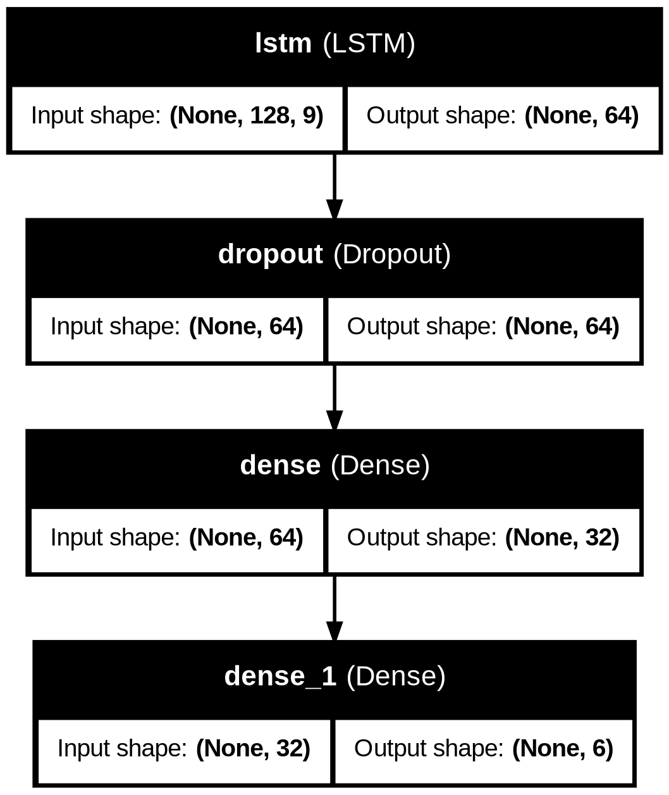
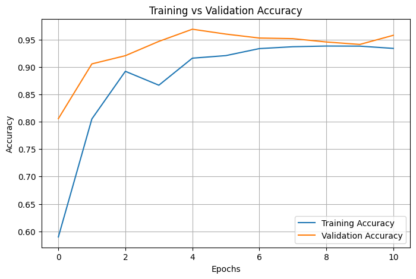
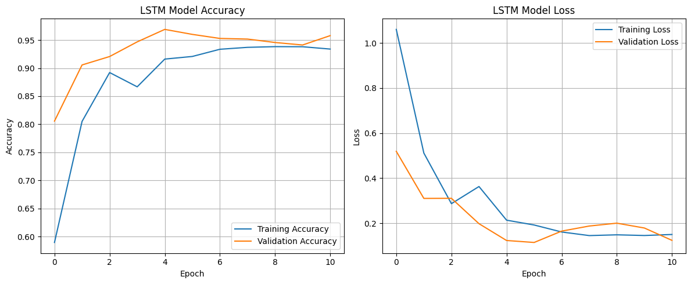
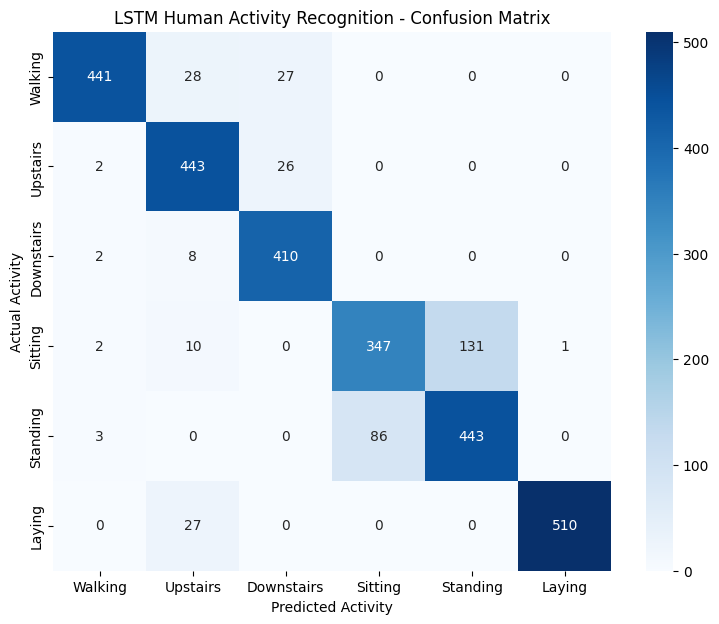

# Human Activity Recognition Using LSTM

A Deep Learning-based approach for classifying human physical activities using smartphone inertial sensor data.

## 1. Project Overview

Human Activity Recognition (HAR) involves identifying physical activities based on sensor data collected from devices such as smartphones and wearable sensors.

This project implements a Long Short-Term Memory (LSTM) network to recognize human activities using accelerometer and gyroscope readings. The model learns temporal patterns from sequential sensor data and classifies each input into one of six activity categories.

The implementation uses the UCI Human Activity Recognition Using Smartphones dataset.

## 2. Objectives

* Develop an LSTM-based Deep Learning model for activity classification.
* Process and analyze sequential smartphone sensor data.
* Apply data preprocessing and feature normalization.
* Evaluate model performance using standard classification metrics.
* Analyze classification results using a confusion matrix.

## 3. Dataset

**UCI Human Activity Recognition Using Smartphones Dataset**

Source: [UCI Machine Learning Repository](https://archive.ics.uci.edu/dataset/240/human+activity+recognition+using+smartphones)

The dataset contains smartphone sensor recordings collected from participants performing six physical activities.

### Dataset Specifications

| Parameter             | Details |
| --------------------- | ------- |
| Training samples      | 7,352   |
| Testing samples       | 2,947   |
| Sensor channels       | 9       |
| Time steps per sample | 128     |
| Activity classes      | 6       |

### Sensor Signals

The following nine raw inertial signals were used:

* Body acceleration: X, Y, Z
* Body gyroscope: X, Y, Z
* Total acceleration: X, Y, Z

### Activity Classes

1. Walking
2. Walking Upstairs
3. Walking Downstairs
4. Sitting
5. Standing
6. Laying

## 4. Technologies and Libraries

* **Programming Language:** Python
* **Deep Learning Framework:** TensorFlow and Keras
* **Data Processing:** NumPy, Pandas
* **Machine Learning Utilities:** Scikit-learn
* **Visualization:** Matplotlib, Seaborn
* **Development Environment:** Google Colab

## 5. Data Preprocessing

The following preprocessing steps were performed:

1. Loaded the raw inertial sensor signals from the training and testing datasets.
2. Combined the nine sensor channels into sequential input arrays.
3. Converted activity labels into zero-based integer labels.
4. Split the official training data into training and validation subsets using a subject-independent split.
5. Applied StandardScaler normalization using statistics fitted exclusively on the training subset.

**Model input shape:** `(128, 9)`

Each input sample represents 128 time steps across nine sensor channels.

## 6. Model Architecture

A Sequential LSTM architecture was developed using TensorFlow and Keras.

| Layer        | Configuration               |
| ------------ | --------------------------- |
| Input        | 128 time steps, 9 features  |
| LSTM         | 64 units                    |
| Dropout      | 0.3                         |
| Dense        | 32 units, ReLU activation   |
| Output Dense | 6 units, Softmax activation |

### Architecture Diagram



### Training Configuration

| Parameter               | Value                           |
| ----------------------- | ------------------------------- |
| Optimizer               | Adam                            |
| Loss Function           | Sparse Categorical Crossentropy |
| Batch Size              | 64                              |
| Maximum Epochs          | 40                              |
| Early Stopping Patience | 5                               |
| Best Weights            | Restored using EarlyStopping    |

Early stopping was used to monitor validation loss and reduce unnecessary training when the model stopped improving.

## 7. Model Evaluation and Results

The trained model was evaluated on the official test dataset containing 2,947 samples.

### Overall Performance

| Metric                   |     Result |
| ------------------------ | ---------: |
| Training Accuracy        |     93.39% |
| Best Validation Accuracy |     96.89% |
| Test Accuracy            | **88.02%** |
| Macro F1-score           |       0.88 |
| Weighted F1-score        |       0.88 |

### Training and Validation Accuracy



### Validation Loss



### Confusion Matrix



### Classification Report

| Activity           | Precision | Recall | F1-score |
| ------------------ | --------: | -----: | -------: |
| Walking            |      0.98 |   0.89 |     0.93 |
| Walking Upstairs   |      0.86 |   0.94 |     0.90 |
| Walking Downstairs |      0.89 |   0.98 |     0.93 |
| Sitting            |      0.80 |   0.71 |     0.75 |
| Standing           |      0.77 |   0.83 |     0.80 |
| Laying             |      1.00 |   0.95 |     0.97 |

### Result Analysis

The model achieved an overall test accuracy of 88.02%.

* Laying achieved the highest F1-score of 0.97.
* Walking and walking downstairs achieved F1-scores of 0.93.
* Sitting and standing were comparatively challenging to distinguish.
* The confusion matrix indicates that some sitting samples were classified as standing and vice versa.

## 8. Repository Structure

```text
Human-Activity-Recognition-LSTM/
│
├── HAR_LSTM.ipynb
├── human_activity_lstm.keras
├── README.md
├── requirements.txt
│
├── LSTM_accuracygraph.png
├── LSTM_confusionmatrix.png
├── LSTM_model.png
└── LSTM_validationlossgraph.png
```

## 9. Installation and Execution

### Clone the Repository

```bash
git clone https://github.com/Dhanyasri23/Human-Activity-Recognition-LSTM.git
```

### Navigate to the Project Directory

```bash
cd Human-Activity-Recognition-LSTM
```

### Install Dependencies

```bash
pip install -r requirements.txt
```

### Download the Dataset

Download the UCI HAR dataset from the official source and extract it.

### Run the Notebook

Open `HAR_LSTM.ipynb` using Google Colab or Jupyter Notebook.

Update the dataset path according to your environment and execute the notebook cells to perform preprocessing, model training and evaluation.

**Note:** The saved `.keras` file contains the trained model. For reproducible predictions, the same sensor ordering and training-fitted normalization must be applied to new input data.

## 10. Future Enhancements

* Improve classification performance for similar activities, particularly sitting and standing.
* Experiment with Bidirectional LSTM architectures.
* Explore hybrid CNN-LSTM models.
* Develop a real-time activity recognition application.
* Evaluate model performance on additional sensor datasets.

## 11. Author

**SRI**

---

*Developed as a Deep Learning project to explore sequential sensor data analysis and human activity classification.*
